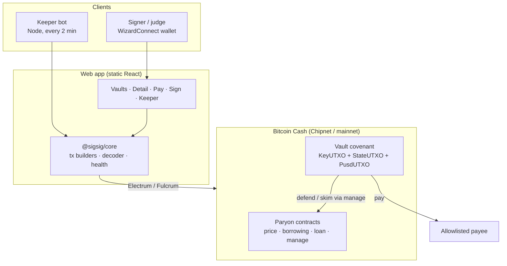

# sigsig

> **Built for [BCH BLAZE 2026](https://bchblaze.cash/) (mainnet track).**
> Deck: **TODO** (Widget Factory template, link goes here) · Code: this repo ·
> Vote with EMBER2026: **TODO** (token-aware `bitcoincash:z…` address goes here)
>
> sigsig is a Bitcoin Cash re-implementation of [Cermin](https://github.com/yeheskieltame/Cermin) (Mezo Hackathon 2
> winner), with spending controls from [Wysiwys](https://github.com/chiwjieren/wysiwys). It builds on
> [ParyonUSD](https://paryonusd.com/)'s audited contracts. **Our covenant is not audited, so use small amounts only.**

sigsig is a treasury vault for Bitcoin Cash. An organisation that holds BCH can borrow **ParyonUSD (PUSD)** against
it without selling. The vault keeps the loan safe, and it pays only payees the signers approved in advance.

The vault is a CashScript covenant. It does three things:

1. **Borrows PUSD** against BCH collateral, using Paryon's own audited contracts (`Borrowing`, `Loan`, `manage`).
2. **Defends itself.** Anyone (a bot, a judge, a passer-by) can send a *defend* transaction when the loan nears
   liquidation, or a *skim* transaction when it holds too much collateral. The covenant accepts only transactions that
   make the position safer, and none of them can move value out of the vault. Nobody needs a key or permission.
3. **Pays bills by rules the chain enforces.** An M-of-N group of signers can pay only allowlisted payees, at most X per
   payment and Y per day. Before anyone signs, the signer view decodes the exact transaction: *what you see is what you
   sign*.

## Credits

sigsig is not a new idea, and we want to be clear about where it comes from.

| Project | What we took | Link |
|---|---|---|
| **Cermin**, winner of Mezo Hackathon 2 | The core design: a per-user vault, a keeper and a savings buffer, first built on Mezo (BTC/MUSD). sigsig re-implements it on Bitcoin Cash with PUSD, and replaces the whitelisted keeper with a covenant that anyone can call. | [github.com/yeheskieltame/Cermin](https://github.com/yeheskieltame/Cermin) |
| **Wysiwys** ("what you see is what you sign") | The spending-control layer: payee allowlist, per-payment limit, daily budget, and a signer view that decodes the transaction | [github.com/chiwjieren/wysiwys](https://github.com/chiwjieren/wysiwys) |
| **ParyonUSD** | The stablecoin and its audited loan contracts (audit by Sighash Labs). We call them as they are, from `@paryonusd/contracts@1.1.0`, and never modify them. | [github.com/ParyonUSD/contracts](https://github.com/ParyonUSD/contracts) |
| **Backstop** | Reference for building Paryon transactions without the closed-source `@paryonusd/library` | [github.com/Emediong-Etuk/Backstop](https://github.com/Emediong-Etuk/Backstop) |
| CashScript, libauth, WizardConnect | Compiler, transaction library, wallet connection | [cashscript.org](https://cashscript.org/) |

No code is copied from Cermin or Wysiwys: sigsig re-implements their ideas in CashScript and TypeScript. The design
notes are dated in their headers, and the git history shows when each part was written.

## Features

| Feature | Who uses it | Enforced by |
|---|---|---|
| Open a vault (loan key, state NFT, first borrow) | Treasury admins | Paryon `Borrowing` + our `Vault` covenant |
| Health: collateral ratio (CR), liquidation price, buffer, interest | Everyone | Read from the loan NFT and Paryon's price contract |
| **Defend:** move buffer BCH into collateral, or burn buffer PUSD to repay | Anyone | `Vault.defend`: strictly safer, no value out |
| **Skim:** move excess collateral back into the buffer | Anyone | `Vault.skim`: CR stays at or above target |
| **Pay:** to an allowlisted payee, within the per-payment and daily limits | M-of-N signers | `Vault.pay` |
| Signer view: decoded inputs and outputs, policy checks, CR after payment | Each signer | Client-side decoder; the covenant re-checks everything |
| Admin: repay, withdraw, change interest, change policy, emergency exit | M-of-N signers | `Vault.admin*`, `Vault.exit` |
| Keeper bot: runs defend/skim every 2 minutes | Anyone can run one | Same builders as the web app |
| Wallet connection | Everyone | WizardConnect |
| Savings in Paryon's stability pool *(stretch)* | M-of-N signers | Paryon `StabilityPool` |

## How it works



The vault is **one covenant script that holds three UTXOs**:

- **KeyUTXO** holds Paryon's loan key NFT, so the vault, not a person, owns the loan.
- **StateUTXO** holds the buffer BCH and a mutable state NFT. The NFT's 52-byte commitment stores the policy: the
  defend, target and skim CR thresholds, the keeper fee cap, the payee merkle root, the per-payment limit, the daily
  budget and today's spending.
- **PusdUTXO** holds the buffer PUSD. A UTXO can carry only one token category, so PUSD needs its own UTXO.

| Function | Signatures | Rule |
|---|---|---|
| `defend()` | none | CR below `defendCR` before; debt down or collateral up; CR reaches `targetCR` or the buffer runs out; only the capped keeper fee leaves |
| `skim()` | none | CR above `skimCR`; debt unchanged; CR stays at or above `targetCR`; the collateral taken goes to the StateUTXO |
| `pay(...)` | M of N | Payee in the allowlist; amount ≤ per-payment limit; today's total ≤ daily budget (day = `tx.locktime / 144`) |
| `admin*`, `exit` | M of N | Manage the loan, change interest or policy, emergency exit |

Paryon liquidates a loan below 110% CR. The covenant uses Paryon's integer formula and compares cross-multiplied
values, so no rounding happens. The full design is in [ARCHITECTURE.md](ARCHITECTURE.md) and
[docs/01-paryon-feasibility-and-covenant-design.md](docs/01-paryon-feasibility-and-covenant-design.md).

## Repository layout

The layout below is the plan; directories appear as they are built (see [IMPLEMENTATION.md](IMPLEMENTATION.md)).

```
contracts/          Vault.cash and its compiled artifact
packages/core/      network config, Paryon deployment loader, readers, tx builders, decoder, policy
packages/keeper/    keeper bot (defend / skim)
packages/oracle/    Chipnet mock oracle and Paryon Chipnet deployer
apps/web/           React app (Vite + TypeScript)
docs/               research notes, BLAZE checklist, deck outline, demo script
```

## Quickstart (Chipnet)

> These are the planned commands. They will be checked on a fresh machine before submission
> (IMPLEMENTATION.md, day 9). Until then, some may not exist yet.

Requirements: Node 22, pnpm, and a Chipnet wallet that supports WizardConnect. Get test BCH from a Chipnet faucet such
as [tbch.googol.cash](https://tbch.googol.cash/).

```bash
pnpm install
pnpm test                      # covenant unit tests (MockNetworkProvider)

# Paryon has no public Chipnet deployment, so we deploy its 26 contracts with our own oracle key
pnpm deploy:chipnet            # writes deployments/chipnet.json
pnpm oracle --price 500        # set BCH = 500.00 PUSD

pnpm --filter web dev          # open the app, connect a Chipnet wallet, create a vault

pnpm oracle --crash 20         # drop the price 20%; the keeper (or you, in /keeper) defends the vault
pnpm keeper                    # run the keeper bot locally
```

## Mainnet demo

The mainnet demo is a vault we funded ourselves against Paryon's mainnet-v1 contracts. Paryon's minimum loan is 100
PUSD, so judges do not need to open one. They can:

1. Open the live demo: **TODO (URL)**.
2. Connect a mainnet wallet with WizardConnect.
3. Run the keeper from `/keeper` (defend or skim, when the vault's CR allows it), or make the small policy-checked demo
   payment. Both are real mainnet transactions, and the fee is a few hundred satoshis.

| Item | Value |
|---|---|
| Live app | TODO |
| Vault address | TODO |
| Loan key category | TODO |
| State NFT category | TODO |
| Example defend / skim tx | TODO |
| Example pay tx | TODO |
| Paryon PUSD token ID (mainnet-v1) | see [docs/01](docs/01-paryon-feasibility-and-covenant-design.md) |

The step-by-step judge walkthrough is in [docs/04-demo-script.md](docs/04-demo-script.md).

## Security notes

- **The vault covenant is unaudited.** It was written in a hackathon week. Use small amounts. The mainnet demo vault
  holds only what we can afford to lose.
- ParyonUSD's contracts are audited; we call them unchanged. Paryon's own risks apply: liquidation below 110% CR, the
  oracle (General Protocols on mainnet), and **redemptions**, which take collateral from the lowest-interest loans
  first.
- Defend and skim are open to anyone because they can only move value between the loan and the vault's own UTXOs. The
  keeper fee is capped by the vault's policy.
- Payments are limited by the allowlist, the per-payment limit and the daily budget, even if M signers are tricked. Only
  `adminPolicy` and `exit` (also M of N) can lift those limits.
- If both the keeper and the buffer fail, the loan can still be liquidated.
- The app never holds keys. Partly signed requests travel in the URL fragment.

## BLAZE 2026

- Hackathon: [bchblaze.cash](https://bchblaze.cash/) ·
  [DoraHacks](https://dorahacks.io/hackathon/bchblaze2026/detail)
- Deck (Widget Factory template): **TODO**
- Video: **TODO**
- EMBER2026 community-choice vote address: **TODO** (token-aware `bitcoincash:z…`)
- Requirements checklist: [docs/02-blaze-requirements.md](docs/02-blaze-requirements.md)

## Licence

[MIT](LICENSE) © sigsig contributors
